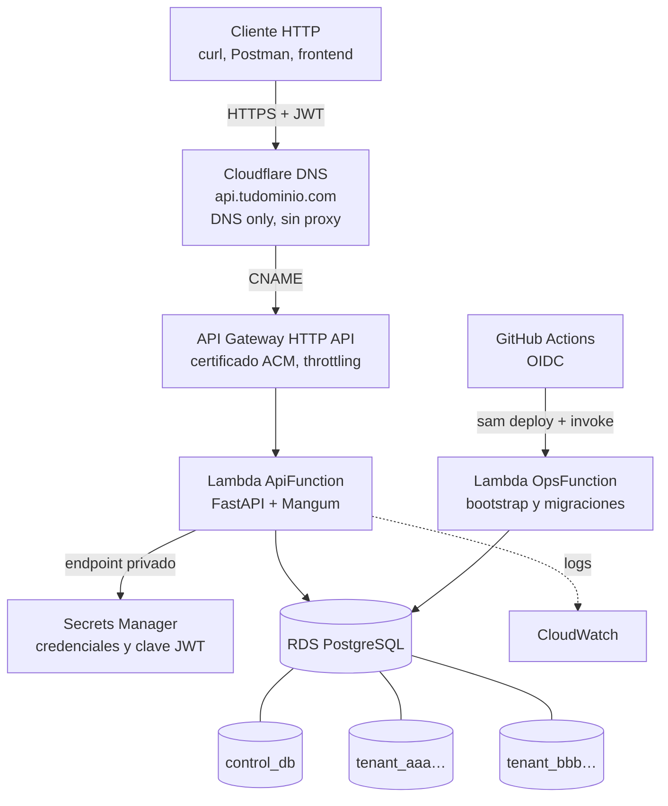

# 1. Arquitectura y explicación del código

Este documento explica **qué hace** el proyecto y **por qué está hecho así**. No necesitas
saber AWS para entenderlo; basta con algo de Python.

## 1.1. La idea en una frase

Varias organizaciones usan la misma API, pero **cada organización guarda sus tareas en su
propia base de datos**. Una base central (`control_db`) sabe quién es quién y quién puede
entrar dónde.

Una analogía: un edificio de oficinas (la API) con una recepción (la `control_db`). La
recepción tiene la lista de empleados y sabe a qué empresa pertenece cada uno. Cada empresa
tiene su propia oficina cerrada con llave (su base de datos). Cuando llegas, la recepción
comprueba tu identificación (JWT), mira si trabajas en esa empresa (membresía) y solo
entonces te da la llave de **esa** oficina.

## 1.2. Vocabulario

| Término | Significado aquí |
|---------|------------------|
| **Tenant** | Una organización (no un usuario). Tiene su propia base de datos. |
| **Membresía** | Relación usuario ↔ organización con un rol: `owner` o `member`. |
| **control_db** | Base central: tablas `users`, `tenants`, `memberships`. |
| **Base de tenant** | Base `tenant_<id>` con la tabla `tasks` de una organización. |
| **JWT** | "Pase" firmado que devuelve el login. Se envía en `Authorization: Bearer <token>`. |
| **Provisión** | Crear la base de datos de una organización nueva, su usuario y sus tablas. |
| **Migración** | Script de Alembic que crea o cambia tablas de forma versionada. |

## 1.3. Componentes en AWS



- **Cloudflare** solo resuelve el nombre `api.tudominio.com`. No toca el tráfico (modo
  *DNS only*, nube gris).
- **API Gateway** recibe HTTPS con tu certificado de **ACM** y pasa cada petición a Lambda.
- **Lambda `ApiFunction`** ejecuta FastAPI. [Mangum](https://mangum.fastapiexpert.com/)
  traduce el evento de API Gateway a una petición ASGI normal.
- **Lambda `OpsFunction`** no tiene URL pública. El pipeline la invoca después de cada
  despliegue para aplicar migraciones de forma controlada.
- **RDS** es un único servidor PostgreSQL con varias bases: `control_db` y una por tenant
  (el enunciado lo permite para el MVP).
- **Secrets Manager** guarda las contraseñas. En `control_db.tenants.secret_arn` solo se
  guarda la *referencia* (ARN) al secreto, nunca la contraseña.
- Todo vive en una **VPC privada**: la base de datos no es accesible desde Internet.

## 1.4. Clean Architecture: las cuatro capas

```
presentation  ──►  application  ──►  domain  ◄──  infrastructure
  (FastAPI)         (casos de uso)     (reglas)     (PostgreSQL, JWT, AWS)
```

La regla de oro: **las flechas apuntan hacia el dominio**. El dominio no sabe que existen
FastAPI, SQLModel ni AWS. Así puedes cambiar la base de datos o el framework sin tocar las
reglas de negocio.

| Capa | Carpeta | Qué contiene | Qué NO puede importar |
|------|---------|--------------|------------------------|
| Dominio | `src/app/domain/` | Entidades (dataclasses), enums, excepciones, contratos | FastAPI, SQLModel, boto3 |
| Aplicación | `src/app/application/` | Un caso de uso por archivo (`execute()`) | Routers, sesiones, AWS |
| Infraestructura | `src/app/infrastructure/` | Implementaciones: SQLModel, Argon2, JWT, Secrets Manager, provisión | Routers |
| Presentación | `src/app/presentation/http/` | Rutas, schemas Pydantic, dependencias, errores | Detalles SQL |
| Config | `src/app/config/` | `Settings` (variables de entorno) y logging | — |

### Mapa de archivos

**Dominio**

- `entities/user.py`, `tenant.py`, `task.py`: clases puras. Generan su `id` (UUID) y sus
  fechas. `Task.apply_changes()` aplica un PATCH. `build_database_name()` genera el nombre de
  la base a partir del id del tenant: el cliente **nunca** lo elige.
- `enums/`: `TenantStatus` (`provisioning`, `active`, `failed`, `suspended`),
  `MembershipRole`, `TaskStatus`, `TaskPriority`.
- `exceptions.py`: errores de negocio. Todos heredan de `DomainError` y tienen un `code`
  (p. ej. `tenant_not_found`).
- `repositories/`: contratos (clases abstractas) de lo que los casos de uso necesitan:
  `UserRepository`, `TenantRepository`, `MembershipRepository`, `TaskRepository`.
- `ports/`: otros contratos: `PasswordHasher`, `TokenService`, `TenantProvisioner`,
  `UnitOfWork` (confirmar transacciones a mitad de un flujo).

**Aplicación**

- `auth/register_user.py`, `login_user.py`, `authenticate_user.py`.
- `tenants/create_tenant.py`, `provision_tenant.py`, `resolve_tenant.py`, `list_tenants.py`.
- `memberships/add_member.py`, `change_member_role.py`, `remove_member.py`,
  `list_members.py`.
- `tasks/create_task.py`, `list_tasks.py`, `get_task.py`, `update_task.py`,
  `delete_task.py`.

**Infraestructura**

- `models/central.py` y `models/tenant.py`: tablas SQLModel. Cada grupo tiene su propio
  `registry`/`metadata`, así Alembic nunca mezcla tablas centrales con tablas de tenant.
- `repositories/sqlmodel_*.py`: implementan los contratos y traducen modelo ↔ entidad con
  `to_domain()`. **Nunca hacen commit**; solo `flush()`.
- `database/central.py`, `tenant.py`: abren una sesión por petición y hacen commit/rollback
  y cierre (incluso si hay excepción).
- `database/engine.py`: crea engines con opciones seguras (`hide_parameters`,
  `pool_pre_ping`, timeouts).
- `database/credentials.py`: obtiene usuario/contraseña de variables (local) o de Secrets
  Manager (AWS).
- `database/pg_admin.py`: sentencias administrativas (crear rol, base, permisos) con
  identificadores validados y escapados.
- `database/migrations.py`: ejecuta Alembic desde código.
- `security/password.py` (Argon2) y `security/jwt.py` (PyJWT).
- `secrets/secret_provider.py`: `AwsSecretsManagerProvider` y `LocalFileSecretProvider`
  (en local, los secretos de los tenants se guardan como JSON en `.local-secrets/`).
- `tenancy/postgres_tenant_provisioner.py`: crea la base de un tenant.
- `tenancy/tenant_database_factory.py`: entrega la conexión correcta para cada tenant.
- `ops/`: bootstrap de `control_db`, migración de todos los tenants y reintento de provisión.
- `container.py`: construye una sola vez los recursos compartidos del proceso.

**Presentación**

- `dependencies.py`: el **punto de composición**. Es el único lugar que junta casos de uso con
  implementaciones concretas (igual que en el proyecto de referencia).
- `routes/auth.py`, `tenants.py`, `tasks.py`: routers delgados: schema → caso de uso →
  schema. Sin `try/except`.
- `schemas/`: contrato HTTP. `RequestModel` usa `extra="forbid"`: un campo desconocido como
  `database_name` produce **422**.
- `error_handlers.py`: el manejador global de errores.
- `middleware.py`: asigna un `X-Request-ID` y registra método, ruta, status y duración.

## 1.5. Recorrido de una petición

`GET /api/v1/tenants/{tenant_id}/tasks?limit=10` con un JWT:

1. **API Gateway → Lambda → Mangum → FastAPI.** El middleware asigna un `request_id`.
2. **Validación del JWT** (`get_current_user` → `AuthenticateUser`): firma, expiración,
   emisor (`iss`) y que el usuario exista y esté activo. Si no, **401**.
3. **Autorización central** (`get_tenant_access` → `ResolveTenant`): con una sesión de
   `control_db` se busca el tenant y la membresía del usuario.
   - No existe el tenant **o** el usuario no es miembro → **404** (no revelamos si existe).
   - Existe pero no está `active` → **409** `tenant_not_active`.
4. **Resolución de conexión** (`get_tenant_session`): `TenantDatabaseFactory` toma
   `database_name` y `secret_arn` **del registro de `control_db`** (nunca del cliente), lee el
   secreto, comprueba que el secreto es de ese tenant y abre una sesión **solo** contra esa
   base.
5. **Caso de uso** (`ListTasks`): valida `limit` (máximo configurable) y llama a
   `SqlModelTaskRepository.list()`. Fíjate que el repositorio **no recibe `tenant_id`**: la
   sesión ya está atada a una única base, así que es imposible leer tareas de otra.
6. **Respuesta** con el schema `TaskListResponse`. Al salir, la sesión hace commit y se
   cierra (o rollback si algo falló).

Ninguna variable global guarda "el tenant actual": cada petición pide su sesión de forma
explícita. Eso evita que, al reutilizar Lambda entre peticiones, se mezclen datos.

## 1.6. Crear una organización (provisión)

`POST /api/v1/tenants` con `{"name": "Acme", "slug": "acme"}` ejecuta `CreateTenant`:

1. Registra el tenant con estado `provisioning` y `database_name = tenant_<uuid sin guiones>`.
2. Crea la membresía del creador con rol `owner`. **Commit** (si lo siguiente falla, la
   organización no se pierde).
3. `PostgresTenantProvisioner` se conecta con la credencial **separada** `tenant_provisioner`
   (puede crear bases y roles, pero no es superusuario) y:
   - crea el rol de PostgreSQL `tenant_<uuid>` con contraseña aleatoria y límite de conexiones;
   - crea la base `tenant_<uuid>` y **revoca el acceso a todos** (`REVOKE ALL … FROM PUBLIC`)
     salvo a ese rol.
4. Guarda usuario y contraseña en Secrets Manager y obtiene el ARN.
5. Aplica las migraciones de `migrations/tenant` y da al rol del tenant solo
   `SELECT/INSERT/UPDATE/DELETE` (nada de crear o borrar tablas).
6. Cambia el estado a `active` y guarda el ARN. Respuesta **201**.

Si algo falla en los pasos 3 a 5, el tenant queda en `failed`, la API responde **503**
`tenant_provisioning_failed` y sus tareas devuelven 409 hasta que se reintente con
`scripts/provision_tenant.py <tenant_id>` (o la acción `provision_tenant` de la Lambda de
operaciones). La provisión es **idempotente**: repetirla completa lo que faltaba.

> ¿Por qué 201 y no 202? La provisión tarda ~1 segundo, así que se hace dentro de la misma
> petición y se devuelve el recurso ya `active`. Si en el futuro se vuelve asíncrona (cola +
> worker), la respuesta pasaría a **202** con estado `provisioning`.

## 1.7. Capas de defensa del aislamiento

| Capa | Qué impide | Dónde |
|------|-----------|-------|
| JWT firmado con `iss`, `exp`, `iat`, `sub` | Suplantar a otro usuario | `infrastructure/security/jwt.py` |
| Membresía verificada en cada petición | Entrar en una organización ajena, o seguir entrando tras ser revocado | `application/tenants/resolve_tenant.py` |
| 404 en vez de 403 para tenants ajenos | Descubrir qué organizaciones existen | `ResolveTenant` |
| Conexión elegida desde `control_db` | Que el cliente apunte a otra base | `tenant_database_factory.py` |
| Secreto verificado (`dbname` y `username` = tenant) | Un registro manipulado que apunte al secreto de otro tenant | `tenant_database_factory.py` |
| Una base por tenant, sin `tenant_id` | Que un `WHERE` olvidado filtre datos | Diseño |
| Rol de PostgreSQL por tenant + `REVOKE CONNECT FROM PUBLIC` | Que una credencial de un tenant abra otra base o `control_db` | `pg_admin.py` |
| Roles con permisos mínimos | Que la API cree/borre tablas o bases | `pg_admin.grant_dml` |
| `extra="forbid"` en los schemas | Colar `database_name`, `secret_arn`, `created_by`… | `schemas/common.py` |
| Errores sin detalles internos | Filtrar SQL, trazas, contraseñas o nombres de bases | `error_handlers.py` |

Todas estas defensas tienen pruebas en `tests/security/`.

## 1.8. Gestión de conexiones

Lambda puede ejecutar muchas copias a la vez y cada una abriría conexiones a PostgreSQL. Para
no agotar el servidor:

- `control_db`: un engine por contenedor Lambda con pool pequeño (`CENTRAL_POOL_SIZE=2`).
- Tenants: `TenantDatabaseFactory` guarda como máximo `TENANT_ENGINE_CACHE_SIZE` engines (uno
  por tenant, LRU) con pool de 1 + 1, y los descarta tras `TENANT_ENGINE_TTL_SECONDS`.
- Cada rol de tenant tiene `CONNECTION LIMIT` (`TENANT_DB_CONNECTION_LIMIT=5`).
- API Gateway limita peticiones por segundo y `LambdaReservedConcurrency` puede limitar las
  Lambdas simultáneas.
- **RDS Proxy** queda evaluado y documentado en [preguntas y decisiones](06-preguntas-y-decisiones.md#rds-proxy).

## 1.9. Manejo de errores

Todas las respuestas de error tienen la misma forma:

```json
{
  "error": {
    "code": "tenant_not_found",
    "message": "Organización no encontrada",
    "request_id": "9b0c…",
    "details": [ … solo en errores 422 … ]
  }
}
```

| Excepción | HTTP |
|-----------|------|
| `ValidationError` (regla de negocio) | 400 |
| `AuthenticationError` | 401 |
| `PermissionDeniedError` | 403 |
| `NotFoundError` | 404 |
| `ConflictError` (duplicados, tenant no activo, último owner) | 409 |
| Validación de Pydantic | 422 (sin repetir el valor enviado) |
| `ServiceUnavailableError`, base de datos caída | 503 |
| Cualquier otra | 500 genérico |

Los logs solo registran el **tipo** de excepción y el `request_id`. Con el `request_id` de
una respuesta puedes buscar el log exacto en CloudWatch.

## 1.10. Migraciones

- `migrations/central` (tabla de versión `alembic_version_central`): `users`, `tenants`,
  `memberships`.
- `migrations/tenant` (tabla `alembic_version_tenant`): `tasks`.

Nunca se ejecutan al arrancar la Lambda de la API. Se ejecutan:

- al crear un tenant (solo en su base nueva);
- con `scripts/bootstrap_database.py` y `scripts/migrate_tenants.py` (local);
- con la Lambda de operaciones, que el pipeline invoca tras cada despliegue.

Para crear una migración nueva de tenant:

```bash
# 1. Cambia src/app/infrastructure/models/tenant.py
# 2. Genera el script comparando contra una base de tenant existente:
uv run alembic -c alembic-tenant.ini -x database=tenant_<id> revision --autogenerate -m "añade assignee"
# 3. Revisa el archivo generado en migrations/tenant/versions/
# 4. Aplícala a todos los tenants:
uv run python scripts/migrate_tenants.py
```

## 1.11. Cómo añadir una funcionalidad (de dentro hacia fuera)

Ejemplo: añadir `assignee_id` a las tareas.

1. **Dominio**: campo en `entities/task.py` (y su regla en `apply_changes`).
2. **Aplicación**: aceptar el campo en `CreateTask` / `UpdateTask`.
3. **Infraestructura**: columna en `models/tenant.py`, mapeo en
   `sqlmodel_task_repository.py` y migración de tenant.
4. **Presentación**: campo en `schemas/tasks.py`.
5. **Pruebas**: un caso en `tests/api/test_tasks.py`.

## 1.12. Diferencias con el proyecto de referencia (ecommerce)

Se mantienen sus convenciones (entidades puras, repositorios como contrato, casos de uso con
`execute()`, transacciones fuera del repositorio, `dependencies.py` como composición) y se
aplican las mejoras que anotamos:

- Los modelos SQLModel están en **infrastructure**, no en el dominio.
- Entidades tipadas con `dataclass(slots=True)` que validan sus invariantes.
- **Manejador global de errores** en lugar de `try/except` en cada endpoint.
- Autenticación, paginación, logging con `request_id` y contexto de tenant.
- Un solo adaptador de persistencia (SQLModel). El adaptador de SQL directo del ecommerce no
  aporta en este MVP; SQL directo solo se usa para tareas administrativas (`pg_admin.py`).
