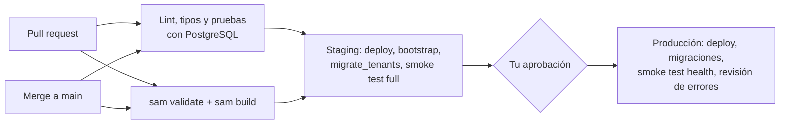

# 3. Setup en AWS paso a paso (desde cero)

Esta guía asume que **nunca has usado AWS**. Sigue los pasos en orden; cada uno dice qué
hacer, dónde hacer clic y cómo comprobar que salió bien.

> Convenciones: `tudominio.com` es tu dominio. Región: **us-east-1 (N. Virginia)**. Si eliges
> otra, úsala en **todos** los pasos (el certificado ACM debe estar en la misma región que la
> API) y cambia `region` en `samconfig.toml`.

## Mapa de lo que vas a hacer

| Paso | Dónde | Lo haces tú o la plantilla |
|------|-------|----------------------------|
| 1. Cuenta, MFA y presupuesto | Consola AWS | Tú |
| 2. Usuario administrador (IAM Identity Center) | Consola AWS | Tú |
| 3. Herramientas: AWS CLI y SAM CLI | Tu computadora | Tú |
| 4. Dominio en Cloudflare | Cloudflare | Tú |
| 5. Certificado ACM + validación DNS | AWS + Cloudflare | Tú |
| 6. Primer despliegue (VPC, **RDS**, **Secrets Manager**, Lambda, **API Gateway**, CloudWatch) | Terminal | **La plantilla SAM** |
| 7. Bootstrap de la base de datos | Terminal | Tú (un comando) |
| 8. Registro DNS de la API en Cloudflare (DNS only) | Cloudflare | Tú |
| 9. OIDC para GitHub Actions | Terminal + GitHub | Tú |
| 10. Producción | GitHub | El pipeline, con tu aprobación |

RDS, Secrets Manager, API Gateway, Lambda, la VPC, los roles IAM de las Lambdas y CloudWatch
**no se crean a mano**: los crea `infra/template.yaml`. En los pasos te digo dónde verlos.

## Costes aproximados (us-east-1, por ambiente, 24/7)

| Recurso | Aprox. USD/mes |
|---------|----------------|
| RDS `db.t4g.micro` + 20 GB gp3 | 12–15 |
| Endpoint privado de Secrets Manager (1 zona) | ~7.5 |
| Secrets Manager (0,40 por secreto: 4 fijos + 1 por organización) | 2+ |
| Lambda, API Gateway, CloudWatch (poco tráfico) | < 1 |
| **Total staging** | **≈ 22–25** |

Producción es otro tanto. Consejo: despliega solo **staging** hasta que lo necesites de verdad,
y revisa si tu cuenta tiene créditos del Free Tier vigente
(<https://aws.amazon.com/free/>). Al final de la guía está cómo **borrar todo**.

---

## Paso 1. Crear la cuenta de AWS y protegerla

1. Ve a <https://aws.amazon.com/> → **Create an AWS Account**.
2. Usa un email que revises. Este email + contraseña es el **usuario raíz** (root): tiene
   poder total, lo usarás casi nunca.
3. Introduce una tarjeta (AWS cobra por uso) y verifica tu teléfono. Plan de soporte:
   **Basic (gratis)**.
4. Entra en la consola como root: <https://console.aws.amazon.com/>.
5. **Activa MFA en root**: arriba a la derecha (tu nombre) → **Security credentials** →
   **Assign MFA device** → *Authenticator app* → escanea el QR con Google Authenticator,
   Authy o similar.
6. **Presupuesto con alerta**: busca **Billing and Cost Management** → **Budgets** →
   **Create budget** → *Use a template* → **Monthly cost budget** → importe, p. ej. 30 USD →
   tu email → **Create**. Te llegará un correo si te acercas.

✅ Comprobación: en *Security credentials* aparece tu dispositivo MFA.

## Paso 2. Crear tu usuario de trabajo (IAM Identity Center)

No trabajes con root. Crea un usuario administrador con acceso temporal (sin claves
permanentes):

1. En la consola, busca **IAM Identity Center** → **Enable** (elige la región us-east-1).
2. **Users** → **Add user** → tu nombre de usuario y email → **Next** → **Add user**. Te
   llegará un email para poner contraseña y MFA: acéptalo.
3. **Permission sets** → **Create permission set** → *Predefined* →
   **AdministratorAccess** → nombre `AdministratorAccess` → **Create**.
4. **AWS accounts** → marca tu cuenta → **Assign users or groups** → tu usuario →
   permission set `AdministratorAccess` → **Submit**.
5. En **Settings** (o en el *Dashboard*) copia el **AWS access portal URL**
   (algo como `https://d-xxxxxxxxxx.awsapps.com/start`). Guárdalo.

✅ Comprobación: abre el portal, entra con tu usuario y verás tu cuenta con el rol
`AdministratorAccess`.

> Alternativa más simple pero menos segura: **IAM → Users → Create user** con la política
> `AdministratorAccess` y una *access key* para la CLI. Si la usas, actívale MFA y no
> compartas nunca la clave.

## Paso 3. Instalar AWS CLI y SAM CLI

1. **AWS CLI v2**: <https://docs.aws.amazon.com/cli/latest/userguide/getting-started-install.html>
2. **AWS SAM CLI**: <https://docs.aws.amazon.com/serverless-application-model/latest/developerguide/install-sam-cli.html>
3. Conecta la CLI con tu usuario del paso 2:

   ```bash
   aws configure sso
   # SSO session name: mi-sso
   # SSO start URL: (el AWS access portal URL del paso 2)
   # SSO region: us-east-1
   # Se abre el navegador: acepta.
   # CLI default client Region: us-east-1
   # CLI default output format: json
   # CLI profile name: default
   ```

4. Comprueba:

   ```bash
   aws sts get-caller-identity   # debe mostrar tu Account y un ARN con AdministratorAccess
   sam --version
   ```

   Cuando la sesión caduque (horas), renueva con `aws sso login`.

5. Apunta tu **Account ID** (12 dígitos, sale en el comando anterior).

## Paso 4. Tu dominio en Cloudflare

Cloudflare solo administrará el DNS (nada de proxy, workers ni hosting).

- **Si aún no tienes dominio**: Cloudflare → **Domain Registration** → **Register Domains** y
  cómpralo ahí (ya queda administrado por Cloudflare).
- **Si ya tienes un dominio en otro registrador** (GoDaddy, Namecheap…):
  1. Cloudflare → **Add a domain** → escribe `tudominio.com` → plan **Free**.
  2. Cloudflare te muestra **dos nameservers** (p. ej. `ana.ns.cloudflare.com`).
  3. En tu registrador, cambia los nameservers del dominio por esos dos.
  4. Espera a que Cloudflare marque el dominio como **Active** (minutos a 24 h).

Nombres que usaremos:

| Ambiente | Nombre |
|----------|--------|
| Staging | `api-staging.tudominio.com` |
| Producción | `api.tudominio.com` |

✅ Comprobación: el dominio aparece **Active** en Cloudflare.

## Paso 5. Certificado TLS en ACM (validado por DNS en Cloudflare)

1. Consola AWS, **región us-east-1** (selector arriba a la derecha) → busca
   **Certificate Manager** → **Request** → *Request a public certificate* → **Next**.
2. **Fully qualified domain name**: `api.tudominio.com` → **Add another name to this
   certificate** → `api-staging.tudominio.com`. (Un solo certificado para los dos ambientes.)
3. Validation method: **DNS validation** → Key algorithm: RSA 2048 → **Request**.
4. Abre el certificado (estado *Pending validation*). En **Domains** verás, por cada nombre,
   un **CNAME name** y un **CNAME value**.
5. En Cloudflare → tu dominio → **DNS** → **Records** → **Add record**, uno por cada fila:
   - **Type**: `CNAME`
   - **Name**: el *CNAME name* de ACM **sin** `.tudominio.com.` al final
     (p. ej. `_3f2a…api` en lugar de `_3f2a…api.tudominio.com.`)
   - **Target**: el *CNAME value* (termina en `.acm-validations.aws.`; el punto final da igual)
   - **Proxy status**: **DNS only** (nube **gris**). Muy importante.
   - **Save**.
6. Espera 5–30 minutos hasta que ACM muestre **Issued**.
7. Copia el **ARN** del certificado (`arn:aws:acm:us-east-1:123456789012:certificate/…`).

✅ Comprobación: estado **Issued** en ACM. No borres esos registros de Cloudflare: ACM los usa
para renovar el certificado automáticamente.

## Paso 6. Primer despliegue de staging (desde tu computadora)

Hacerlo una vez a mano te ayuda a entender qué pasa; después lo hará el pipeline.

```bash
cd multitenant-task-api
sam build --build-in-source
sam deploy --config-env staging \
  --parameter-overrides \
    Stage=staging VpcCidr=10.20.0.0/16 \
    DomainName=api-staging.tudominio.com \
    CertificateArn=arn:aws:acm:us-east-1:123456789012:certificate/xxxx
```

- `sam build` empaqueta el código, las migraciones y las dependencias para Linux (objetivo
  `build-ApiFunction` del `Makefile`).
- `sam deploy` sube el paquete a un bucket S3 que SAM crea solo, y crea el stack de
  CloudFormation `multitenant-task-api-staging`. **Tarda 15–25 minutos** la primera vez
  (sobre todo RDS).

Mientras esperas, mira qué se está creando en la consola:

| Qué | Dónde verlo |
|-----|-------------|
| El stack y su progreso | **CloudFormation** → Stacks → `multitenant-task-api-staging` → *Events* |
| VPC privada, subredes, grupos de seguridad, endpoint de Secrets Manager | **VPC** |
| Servidor PostgreSQL (privado, cifrado, sin acceso público) | **RDS** → Databases |
| Secretos: `…/central-db`, `…/provisioner-db`, `…/jwt` y el de RDS (`rds!db-…`) | **Secrets Manager** |
| Lambdas `ApiFunction` y `OpsFunction` | **Lambda** |
| HTTP API y dominio personalizado | **API Gateway** → APIs / Custom domain names |
| Logs y alarmas | **CloudWatch** |

Al terminar, `sam deploy` imprime los **Outputs**. Apunta:

- `ApiUrl` (URL por defecto, `https://xxxx.execute-api.us-east-1.amazonaws.com`)
- `CustomDomainTarget` (algo como `d-abc123.execute-api.us-east-1.amazonaws.com`)
- `OpsFunctionName`

Puedes volver a verlos con:

```bash
aws cloudformation describe-stacks --stack-name multitenant-task-api-staging \
  --query "Stacks[0].Outputs" --output table
```

> Si solo quieres probar sin dominio, deja `DomainName=""` y `CertificateArn=""` y usa
> `ApiUrl`.

## Paso 7. Bootstrap de la base de datos (migraciones controladas)

La base de datos está en una red privada, así que no puedes conectarte desde tu computadora.
Para eso existe la Lambda de operaciones:

```bash
OPS=$(aws cloudformation describe-stacks --stack-name multitenant-task-api-staging \
  --query "Stacks[0].Outputs[?OutputKey=='OpsFunctionName'].OutputValue" --output text)

scripts/invoke_ops.sh "$OPS" '{"action": "bootstrap"}'
scripts/invoke_ops.sh "$OPS" '{"action": "migrate_tenants"}'
```

`bootstrap` usa el usuario maestro de RDS para crear `app_central`, `tenant_provisioner`,
`control_db`, aplicar `migrations/central` y los permisos. Es idempotente: el pipeline lo
ejecuta en cada despliegue.

✅ Comprobación:

```bash
curl https://xxxx.execute-api.us-east-1.amazonaws.com/health/ready
# {"status":"ready"}
```

## Paso 8. Apuntar `api-staging.tudominio.com` a API Gateway (Cloudflare, DNS only)

1. Cloudflare → tu dominio → **DNS** → **Records** → **Add record**:
   - **Type**: `CNAME`
   - **Name**: `api-staging`
   - **Target**: el `CustomDomainTarget` del paso 6 (`d-abc123.execute-api.us-east-1.amazonaws.com`)
   - **Proxy status**: **DNS only** (nube gris)
   - **TTL**: Auto → **Save**
2. Comprueba (puede tardar unos minutos):

   ```bash
   nslookup api-staging.tudominio.com      # debe resolver a direcciones de AWS
   curl -i https://api-staging.tudominio.com/health
   # HTTP/2 200 … {"status":"ok"}
   ```

3. Abre `https://api-staging.tudominio.com/docs` en el navegador: el candado debe mostrar el
   certificado de Amazon para tu dominio.

> ¿Por qué *DNS only*? Con el proxy (nube naranja), Cloudflare terminaría el TLS con su propio
> certificado y reenviaría el tráfico; el enunciado pide que Cloudflare **solo** gestione el
> DNS y que HTTPS lo sirva API Gateway con el certificado de ACM.

**Registros DNS que quedan documentados:**

| Tipo | Nombre | Destino | Proxy | Para qué |
|------|--------|---------|-------|----------|
| CNAME | `_xxxx.api` | `_yyyy.acm-validations.aws` | DNS only | Validación/renovación ACM (`api`) |
| CNAME | `_xxxx.api-staging` | `_yyyy.acm-validations.aws` | DNS only | Validación/renovación ACM (`api-staging`) |
| CNAME | `api-staging` | `d-…execute-api.us-east-1.amazonaws.com` | DNS only | API de staging |
| CNAME | `api` | `d-…execute-api.us-east-1.amazonaws.com` | DNS only | API de producción (paso 10) |

## Paso 9. GitHub Actions con OIDC (sin claves de AWS en GitHub)

OIDC permite que GitHub pida a AWS **credenciales temporales** (1 hora) para un rol concreto,
y solo desde tu repositorio y tu environment. No se guarda ninguna clave.

### 9.1. Crear el proveedor OIDC y los roles (una vez)

```bash
aws cloudformation deploy \
  --template-file infra/github-oidc.yaml \
  --stack-name multitenant-task-api-github-oidc \
  --capabilities CAPABILITY_NAMED_IAM \
  --parameter-overrides GitHubOwner=vanefRiwi RepositoryName=multitenant-task-api

aws cloudformation describe-stacks --stack-name multitenant-task-api-github-oidc \
  --query "Stacks[0].Outputs" --output table
```

- Si da error porque el proveedor `token.actions.githubusercontent.com` ya existe, añade
  `CreateOidcProvider=false` a los `--parameter-overrides`.
- Apunta `StagingDeployRoleArn` y `ProductionDeployRoleArn`.
- Cada rol solo puede ser asumido por jobs del environment correspondiente
  (`repo:vanefRiwi/multitenant-task-api:environment:staging` / `…:production`): permisos de
  staging y producción separados.

### 9.2. Configurar el repositorio en GitHub

1. **Settings → Environments → New environment** → `staging` → **Configure environment**:
   - **Environment variables → Add variable**:

     | Nombre | Valor |
     |--------|-------|
     | `AWS_DEPLOY_ROLE_ARN` | `StagingDeployRoleArn` |
     | `AWS_REGION` | `us-east-1` |
     | `API_DOMAIN` | `api-staging.tudominio.com` (vacío si no usas dominio) |
     | `CERTIFICATE_ARN` | ARN del paso 5 (vacío si no usas dominio) |

   - **Deployment branches**: *Selected branches* → `main`.
2. **New environment** → `production`:
   - Mismas variables con `ProductionDeployRoleArn` y `API_DOMAIN=api.tudominio.com`.
   - **Required reviewers** → añádete a ti. Así **nada llega a producción sin tu aprobación**.
   - **Deployment branches**: `main`.
3. **Settings → Secrets and variables → Actions → Variables (Repository)** → **New repository
   variable** → `DEPLOY_ENABLED` = `true`. (Mientras no exista, el pipeline solo hace lint,
   pruebas y `sam build`, sin desplegar.)
4. **Proteger `main`**: **Settings → Branches → Add branch ruleset** (o *Add rule*) → rama
   `main` → activa *Require a pull request before merging* y *Require status checks to pass*
   (elige **Lint y pruebas** y **Validar y construir SAM**).

### 9.3. Cómo funciona el pipeline (`.github/workflows/ci-cd.yml`)



- En un **pull request**: Ruff (formato y lint), mypy, pruebas de integración, API y
  seguridad contra un PostgreSQL de servicio, validación y build de SAM.
- En un **merge a `main`** (con `DEPLOY_ENABLED=true`): despliega staging, ejecuta las
  migraciones con la Lambda de operaciones y corre `scripts/smoke_test.py --mode full`
  (2 usuarios, 2 organizaciones, aislamiento). Después espera tu aprobación en
  **Actions → (la ejecución) → Review deployments → production → Approve**.
- Producción: despliega, migra, prueba salud y revisa que la Lambda no tenga errores en los
  últimos 10 minutos.
- Ningún secreto se imprime en los logs (las contraseñas solo existen en Secrets Manager).

✅ Comprobación: haz un PR pequeño; en la pestaña **Actions** deben pasar los dos primeros
jobs. Al hacer merge, el job de staging debe terminar en verde.

## Paso 10. Producción

1. Haz merge a `main` y aprueba el job **Desplegar en producción**. La primera vez tarda
   15–25 minutos (otro RDS, otra VPC: recursos y credenciales independientes).
2. En los logs del job (paso *Read stack outputs*) o con `describe-stacks` obtén el
   `CustomDomainTarget` del stack `multitenant-task-api-production`.
3. En Cloudflare crea el CNAME `api` → ese destino, **DNS only**.
4. Comprueba `https://api.tudominio.com/health`.

En producción la base tiene **protección contra borrado** y 7 días de backups.

---

## CloudWatch: errores y métricas

- **Logs de la API**: CloudWatch → **Log groups** → `/aws/lambda/multitenant-task-api-staging-ApiFunction-…`.
  Cada petición deja una línea `GET /api/v1/... -> 200 (12.3 ms) request_id=…`.
- **Buscar un error concreto**: toma el `request_id` de la respuesta de error y usa
  **Logs Insights**:

  ```
  fields @timestamp, @message
  | filter @message like /<request_id>/
  | sort @timestamp desc
  ```

- **Errores recientes**:

  ```
  fields @timestamp, @message
  | filter @message like /ERROR|WARNING/
  | sort @timestamp desc | limit 50
  ```

- **Logs de acceso de API Gateway**: `/aws/apigateway/multitenant-task-api-staging`.
- **Métricas**: Lambda → la función → **Monitor** (invocaciones, errores, duración,
  concurrencia). RDS → la base → **Monitoring** (`DatabaseConnections`, CPU).
- **Alarmas** (CloudWatch → Alarms): `…-lambda-errors` y `…-5xx`. Para recibir un email,
  edita la alarma → *Notification* → crea un tema SNS con tu correo.

## Borrar todo (para no pagar)

```bash
sam delete --stack-name multitenant-task-api-staging --region us-east-1
```

- RDS se borra dejando un **snapshot final** (por seguridad). Si no lo quieres: RDS →
  **Snapshots** → bórralo.
- Los secretos de las organizaciones los crea la aplicación (no la plantilla). Bórralos así:

  ```bash
  aws secretsmanager list-secrets \
    --filters Key=name,Values=multitenant-task-api/staging/tenants/ \
    --query "SecretList[].ARN" --output text | tr '\t' '\n' | \
    xargs -I{} aws secretsmanager delete-secret --secret-id {} --force-delete-without-recovery
  ```

- En producción primero desactiva la protección: RDS → la base → **Modify** → desmarca
  *Enable deletion protection* → *Apply immediately*.
- Borrar una Lambda con VPC puede tardar 20–40 minutos (AWS libera interfaces de red).

## Problemas comunes

| Síntoma | Causa | Solución |
|---------|-------|----------|
| `sam deploy`: *Certificate … not found* | Certificado en otra región o no emitido | Pídelo en la misma región y espera **Issued** |
| ACM se queda en *Pending validation* | CNAME mal copiado o con proxy | Revisa el *Name* (sin el dominio al final) y que la nube esté **gris** |
| `ReservedConcurrentExecutions … decreases account's UnreservedConcurrentExecution below its minimum` | Cuenta nueva con límite de 10 | Deja `LambdaReservedConcurrency=0` o pide más en **Service Quotas** → Lambda → *Concurrent executions* |
| `invoke_ops.sh` termina con *FunctionError* | Falló bootstrap o una migración | Mira los logs de `OpsFunction` en CloudWatch |
| `/health/ready` da 503 | Bootstrap sin ejecutar o RDS arrancando | Paso 7; espera a que RDS esté *Available* |
| Error 403/`Not authorized to perform sts:AssumeRoleWithWebIdentity` en Actions | El *sub* del token no coincide | El job debe tener `environment: staging/production`, y `GitHubOwner`/`RepositoryName` deben coincidir exactamente (mayúsculas incluidas) |
| `curl` al dominio da error de certificado | El CNAME tiene el proxy activo o aún no propaga | Nube gris y espera unos minutos |
| *AccessDenied* en el pipeline al crear algo nuevo | La política `multitenant-task-api-deploy` no cubre ese servicio | Añade la acción a `infra/github-oidc.yaml` y vuelve a desplegar ese stack |
