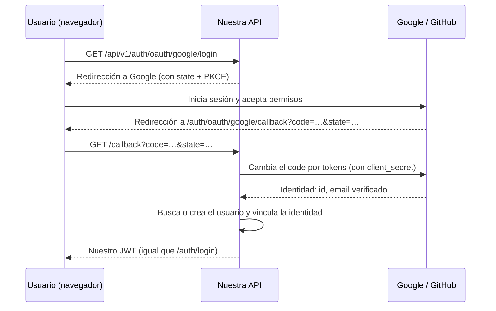

# 5. OAuth con Google y GitHub: qué implica y si conviene ahora

## Respuesta corta

**Recomendación: no implementarlo en este MVP; dejarlo para el siguiente.** No está en el
enunciado (el módulo de autenticación pide registro, login, JWT y `/auth/me`, y eso ya está
hecho), la API no tiene frontend (OAuth es un flujo de navegador) y añade secretos,
configuración y superficie de ataque que no suman a los criterios de aceptación. El código ya
está preparado para añadirlo sin tocar tenants ni tareas.

Si aun así lo quieres ahora, dímelo y lo implemento. Abajo tienes exactamente lo que tendrías
que hacer tú (crear las apps OAuth y guardar los secretos) y lo que haría yo en el código.

## 5.1. Cómo funcionaría (en palabras simples)

OAuth permite "Iniciar sesión con Google/GitHub": el usuario demuestra a Google o GitHub quién
es, y ellos nos lo confirman. Nuestra API sigue emitiendo **su propio JWT** al final, así que
el resto (tenants, membresías, tareas) no cambia.



## 5.2. Lo que tendrías que hacer tú

Crearías **una app OAuth por proveedor y por ambiente** (local, staging, producción), porque
cada una tiene sus URLs de retorno (*callback*).

URLs de callback que usaríamos:

| Ambiente | Google | GitHub |
|----------|--------|--------|
| Local | `http://localhost:8000/api/v1/auth/oauth/google/callback` | `http://localhost:8000/api/v1/auth/oauth/github/callback` |
| Staging | `https://api-staging.tudominio.com/api/v1/auth/oauth/google/callback` | `https://api-staging.tudominio.com/api/v1/auth/oauth/github/callback` |
| Producción | `https://api.tudominio.com/api/v1/auth/oauth/google/callback` | `https://api.tudominio.com/api/v1/auth/oauth/github/callback` |

### Google (Google Cloud Console)

1. Entra en <https://console.cloud.google.com/> con tu cuenta de Google.
2. Arriba, selector de proyecto → **New project** → nombre `multitenant-task-api` → **Create**.
3. Menú → **APIs & Services** → **OAuth consent screen** (en consolas nuevas se llama
   **Google Auth Platform → Branding/Audience**):
   - User type / Audience: **External**.
   - App name, *User support email* y *Developer contact*: tus datos.
   - Scopes (Data access): `openid`, `.../auth/userinfo.email`, `.../auth/userinfo.profile`.
   - **Test users**: añade tu email (mientras la app esté en modo *Testing*, solo esos usuarios
     pueden entrar).
4. **Credentials** (o **Clients**) → **Create credentials → OAuth client ID**:
   - Application type: **Web application**.
   - Name: `multitenant-task-api-staging` (repite para cada ambiente o añade todas las URIs en
     uno; recomiendo uno por ambiente).
   - **Authorized redirect URIs**: la URL de la tabla para ese ambiente.
   - **Create** → copia el **Client ID** y el **Client secret** (el secreto solo se muestra
     completo al crearlo).
5. Para producción con usuarios reales: **Publish app** (pasar de *Testing* a *In
   production*). Con solo `openid/email/profile` normalmente no exige revisión larga.

### GitHub (OAuth App)

1. GitHub → tu foto → **Settings** → **Developer settings** → **OAuth Apps** →
   **New OAuth App**.
2. Rellena:
   - Application name: `multitenant-task-api (staging)`
   - Homepage URL: `https://api-staging.tudominio.com`
   - **Authorization callback URL**: la URL de GitHub de la tabla. Una OAuth App de GitHub
     admite **una sola** callback, por eso hace falta una app por ambiente.
3. **Register application** → copia el **Client ID** → **Generate a new client secret** →
   cópialo (solo se muestra una vez).
4. Permisos que pediríamos: `read:user` y `user:email` (el email de GitHub puede ser privado;
   la API pediría la lista de emails y usaría el principal **verificado**).

### Dónde guardar los secretos

- **Local**: en tu `.env` (nunca en git):

  ```dotenv
  GOOGLE_CLIENT_ID=...
  GOOGLE_CLIENT_SECRET=...
  GITHUB_CLIENT_ID=...
  GITHUB_CLIENT_SECRET=...
  ```

- **AWS**: un secreto por proveedor y ambiente en Secrets Manager (lo añadiría a
  `infra/template.yaml` vacío y tú pegarías el valor en la consola):
  `multitenant-task-api/staging/oauth-google` →
  `{"client_id": "...", "client_secret": "..."}`; igual para `oauth-github`.

## 5.3. Lo que haría yo en el código (si lo confirmas)

Siguiendo la misma arquitectura:

1. **Dominio**: puerto `OAuthProvider` (`authorization_url()`, `exchange_code()` → identidad
   con `provider_user_id` y email verificado) y entidad `OAuthIdentity`.
2. **Migración central**: tabla `oauth_identities` (`user_id`, `provider`,
   `provider_user_id`, único por `provider + provider_user_id`) y `users.password_hash`
   pasaría a ser opcional (usuarios que solo entran con Google).
3. **Aplicación**: caso de uso `LoginWithOAuth`: si la identidad existe → ese usuario; si no,
   y el email está **verificado**, vincula o crea el usuario; después emite el JWT habitual.
4. **Infraestructura**: adaptadores `GoogleOAuthProvider` (valida el `id_token`: firma,
   `iss`, `aud`, `exp`) y `GitHubOAuthProvider`; `state` firmado y **PKCE** contra CSRF.
5. **Presentación**: `GET /auth/oauth/{provider}/login` y `GET /auth/oauth/{provider}/callback`.
6. **Pruebas** de API y seguridad con el proveedor simulado (state inválido, email no
   verificado, cuenta ya vinculada, etc.).

Esfuerzo estimado: 1–2 días, más la creación de las apps por tu parte.

## 5.4. ¿Por qué esperar?

| A favor de hacerlo ahora | A favor de esperar (recomendado) |
|--------------------------|----------------------------------|
| Mejor experiencia de login | No está en el alcance del enunciado |
| No guardar contraseñas de quien use Google/GitHub | Sin frontend, el flujo de redirecciones es incómodo de probar |
| | 6 apps OAuth (2 proveedores × 3 ambientes) y sus secretos |
| | Riesgos nuevos que hay que cubrir con pruebas: vinculación de cuentas, CSRF, emails no verificados |
| | El MVP debe validar primero provisión, conexiones y aislamiento |

Alternativa para el futuro: **Amazon Cognito** con Google y GitHub como proveedores federados
(Cognito gestiona el flujo y emite los tokens). Ahorra código, pero cambia la forma de
validar tokens en toda la API y suma otro servicio; lo evaluaría junto con el frontend.
